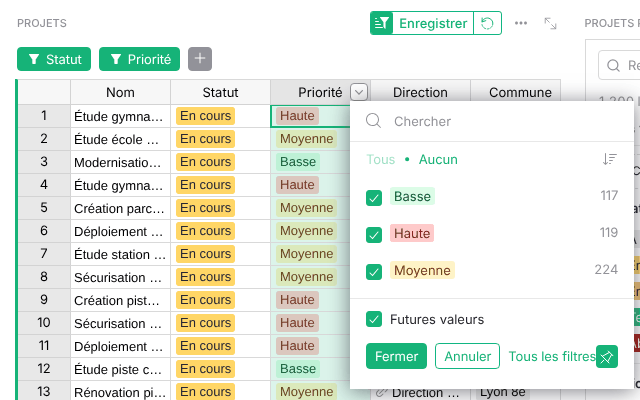

# Filtres — conception

## Le besoin

Les utilisateurs métier filtrent un tableau sur **plusieurs champs à la fois** (statut, priorité,
direction, commune, thématique, période, montant…) et, dans chaque champ, sur **plusieurs valeurs**.
Ils veulent voir d'un coup d'œil ce qui est filtré, revenir en arrière facilement, et ne pas perdre
leurs filtres en changeant de page. Ils n'ont souvent qu'un accès en lecture.

## Benchmark

Solutions essayées sur le même document de test (1 200 projets, puis 30 000) dans un Grist local
(grist-core 1.7.22), et références hors de Grist.

| Critère | Filtres natifs de Grist (menu de colonne, filtres épinglés) | Widget « Drop-down » (ce dépôt) | Tables de synthèse + « Sélectionner par » | Segments Excel / Power BI | Facettes des sites de vente | **Widget Filtres** |
|---|---|---|---|---|---|---|
| Plusieurs champs visibles en même temps | non : un menu ouvert à la fois | non : un seul champ | une table par champ, enchaînées | oui | oui | **oui** |
| Plusieurs valeurs par champ | oui | non | non (une ligne sélectionnée) | oui | oui | **oui** |
| Cases à cocher | oui | non (liste déroulante) | non | boutons | oui | **oui** |
| Nombre de lignes par valeur, selon les autres filtres | oui | non | colonne « count » | grisé si vide | oui | **oui, valeurs sans résultat grisées** |
| Logique | tout coché, on décoche pour exclure | — | — | on coche pour inclure | on coche pour inclure | **on coche pour inclure, « Exclure » au choix, « Seulement »** |
| Montants, dates | min / max, dates relatives | non | non | curseurs, dates relatives | curseurs | **min / max, périodes prêtes, « sans date »** |
| Recherche dans toutes les colonnes | recherche de la page (une occurrence à la fois) | non | non | non | oui | **oui, tous les mots** |
| Filtres actifs visibles, retrait d'un clic | boutons au-dessus du tableau | — | — | effacer par segment | puces + « tout effacer » | **puces, « Tout effacer » + « Annuler »** |
| Utilisable par un lecteur | oui, mais non enregistrable | oui | oui | oui | oui | **oui** |
| Filtres retrouvés au retour | non, sauf si un éditeur les enregistre pour tous | non | non | oui (rapport) | oui (adresse) | **oui, propres à chaque utilisateur** |
| Filtre plusieurs widgets à la fois | non : un tableau à la fois | oui (liaison) | oui (liaison) | oui | — | **oui : tableaux, fiches, graphiques, tables liées par référence** |
| Mise en place | aucune | 1 colonne | une table de synthèse par champ | — | — | **2 minutes : ajouter, accepter, relier** |

La recherche n'a pas trouvé de widget communautaire de Grist couvrant ce besoin.

### Ce que l'on retient

- Des **facettes** comme sur les sites de vente, recommandées par les études d'ergonomie (Baymard,
  Algolia) : cases à cocher plutôt que boutons radio, **nombre de lignes à côté de chaque valeur**
  recalculé selon les autres filtres, valeurs sans résultat **grisées** plutôt que cachées (on
  comprend qu'elles existent), filtres actifs rappelés en **puces** avec « tout effacer », filtres
  **retrouvés** en revenant.
- **Cocher pour inclure** (segments Power BI, sites de vente) plutôt que « tout coché, décocher pour
  exclure » (menus de Grist et d'Excel) : avec 40 directions, garder deux directions demande deux
  clics au lieu de 38. L'exclusion reste possible (« tout sauf Terminé »), clairement signalée en rouge.
- **« Seulement »** au survol (Google Sheets, Tableau) pour passer d'une valeur à une autre en un clic.
- **Effet immédiat**, sans bouton « Appliquer » : le nombre de lignes guide le choix suivant.
- **Aspect de Grist** (couleurs des choix, cases vertes, thème sombre) : le panneau fait partie du
  document, pas d'un autre outil.
- **Aucune liste déroulante maison** : un widget est un cadre dont rien ne peut dépasser ; un menu
  déroulant y serait coupé dès que le widget est peu haut. Les blocs sont donc toujours dépliés dans
  le panneau, et les rares menus sont des listes natives du navigateur (qui, elles, débordent du cadre).

## Fonctionnement avec Grist

Le widget est un **widget personnalisé** posé sur la table à filtrer, déclaré source de sélection
(`allowSelectBy`). Les widgets reliés à lui (« Sélectionner par ») n'affichent que les lignes dont il
transmet les identifiants (`grist.setSelectedRows`). Les essais dans Grist ont montré plusieurs
comportements, lus ensuite dans le code de grist-core, dont le widget tient compte (voir
`js/selection.js`) :

| Comportement de Grist | Conséquence sans précaution | Réponse du widget |
|---|---|---|
| Chaque nouvelle liste ramène le curseur du tableau relié sur sa première ligne (`BaseView.onLinkFilterChange`). | Le tableau saute en haut à chaque modification de données. | Une liste n'est envoyée qu'après une action sur les filtres, jamais après une modification de données. |
| Passer de `null` à une liste recrée la liaison et envoie le curseur sur la ligne d'ajout, tout en bas. | Au premier filtre (et au chargement), on se retrouve en bas du tableau. | Une seconde liste, à peine différente, est envoyée 150 ms après : le curseur revient en haut. |
| Une ligne ajoutée dans le tableau filtré n'a pas d'identifiant dans la liste. | Elle disparaît dès sa création. | La liste réserve les 20 identifiants suivants. |
| Les filtres de Grist laissent visible une ligne que l'on vient de modifier. | Le widget la ferait disparaître, avec un saut du curseur. | La liste n'est pas recalculée ; si d'autres lignes se mettent à correspondre, le panneau propose « Actualiser ». |
| Au-delà de 500 valeurs, Grist affiche « Toute la donnée n'est pas visible » (`QuerySet`, `MAX_SQL_PARAMS`), mais filtre avant de couper la liste. | Message alarmant, faux pour une table ordinaire. | `null` sans filtre actif (pas de message), réserve limitée à 20, et une note dans le panneau quand le message apparaît. |
| Avec `null`, un widget relié par une colonne de référence n'affiche que les lignes liées à la ligne courante du widget. | Sans filtre, la table des tâches n'affiche que les tâches d'un projet. | Le widget lit les liaisons du document ; si un widget lui est relié par référence, il transmet la liste complète (et 0, pour les lignes sans référence). |
| Un widget ne connaît pas son propre numéro de section. | Impossible de savoir lequel des widgets Filtres d'une table on est. | L'identifiant des réglages enregistrés permet de se reconnaître ; à défaut, tous les widgets Filtres de la table comptent. |
| `setOption` garde les réglages « en attente » jusqu'au bouton **Enregistrer** de Grist. | Réglages perdus au rechargement. | Un message le rappelle après chaque enregistrement. |
| Les lecteurs ont `?readonly=true` dans l'adresse du widget. | — | Ni roue dentée ni bandeaux d'aide pour eux. |
| Sans accès accordé, Grist n'envoie aucune donnée. | « Chargement… » sans fin. | Le panneau explique où cliquer sur « Accepter ». |

## Données

- **Réglages** (communs, options du widget `filtres`) : `{ version, id, fields: [{ colId, mode, sort }],
  search, remember, hideEmpty }`. Sans `fields`, les champs sont proposés automatiquement
  (`config.autoFields`) : listes de choix et cases à cocher, deux dates au plus, références, choix
  multiples, deux nombres au plus, textes qui reviennent souvent ; neuf champs au plus.
- **Filtres** (propres à chaque utilisateur, `localStorage`, clé `grist-filtres:<document>:<table>:<id>`) :
  par champ `{ in: [valeurs], not }`, `{ min, max }`, `{ preset }` ou `{ from, to }`, `{ q }` ; plus la
  recherche globale et les blocs repliés.
- **Modes** par type : choix, choix multiples, cases à cocher → cases ; références → cases ou recherche ;
  nombres → plage ou cases ; dates → période, cases par année ou par mois ; texte → cases ou recherche.

## Calcul

Pour chaque ligne, on compte les filtres non satisfaits. Zéro : la ligne est retenue et compte pour
toutes les valeurs de tous les champs. Un seul, dans le champ C : elle compte pour les valeurs de C
seulement (c'est ce que l'on obtiendrait en cochant ces valeurs). Deux ou plus : elle ne compte nulle
part. Un seul passage sur les lignes suffit : 30 000 lignes et 9 champs se filtrent en quelques
dizaines de millisecondes.

## Essais réalisés dans Grist

Grist local (grist-core 1.7.22, Docker), widget servi en local, scripts Playwright :
- ajout du widget depuis la galerie, accord de l'accès, liaison par « Sélectionner par » ;
- filtres combinés sur 1 200 projets : les nombres du tableau relié sont ceux du panneau ;
- exclusion, plage de montants, période, recherche globale, puces, tout effacer et annuler ;
- réglages enregistrés par le bouton de Grist, puis rechargement ; filtres retrouvés au retour ;
- ligne ajoutée et ligne modifiée dans le tableau filtré, modification faite ailleurs (« Actualiser ») ;
- curseur du tableau relié au chargement, après un filtre, après « Tout effacer » ;
- table des tâches reliée par sa colonne « Projet » ;
- disposition en colonne, en grille et en bandeau ; thème sombre ; widget non relié ; lecteur ;
- 30 000 lignes : widget prêt en moins de 3 s (chargement de la page compris), un clic filtre en
  130 à 280 ms (mesures de bout en bout dans Playwright).
