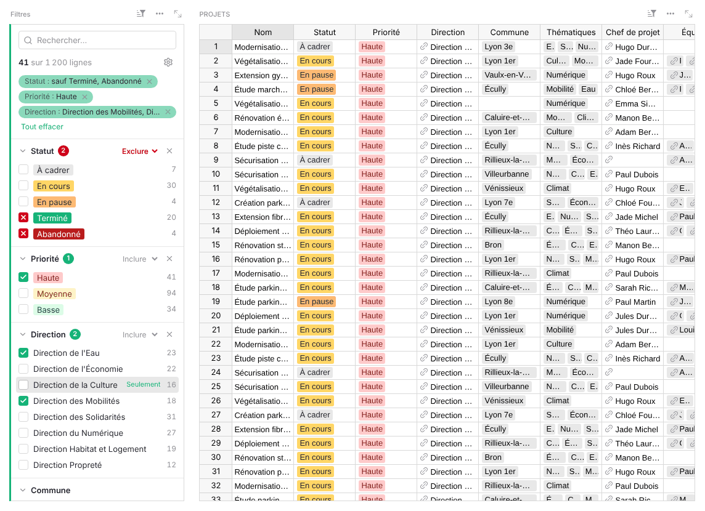
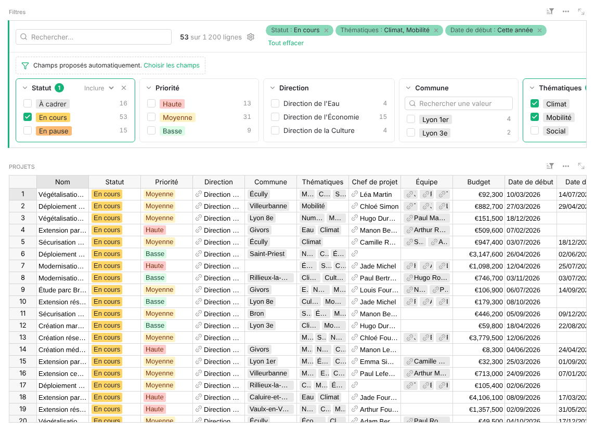
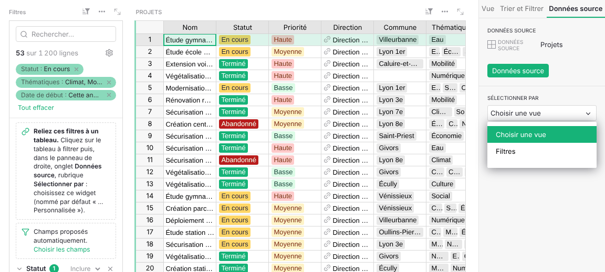
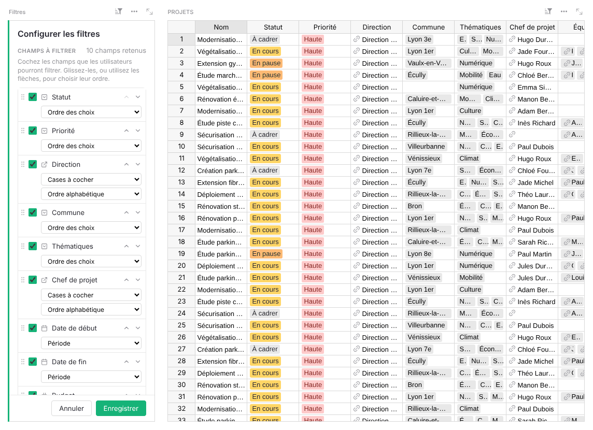

# Filtres — widget Grist 🇫🇷

Un panneau pour filtrer un tableau **sur plusieurs champs à la fois, par cases à cocher**. On coche
« En cours » et « En pause » dans Statut, « Haute » dans Priorité, deux directions, une période… et
le tableau relié n'affiche que les lignes retenues. À côté de chaque valeur, le nombre de lignes que
l'on obtiendrait en la cochant.



## Ce que l'on peut faire

- **Cocher plusieurs valeurs dans plusieurs champs.** Dans un même champ, les valeurs cochées
  s'additionnent (Statut = En cours **ou** En pause) ; d'un champ à l'autre, les conditions se cumulent
  (Statut … **et** Priorité …).
- **Voir le nombre de lignes de chaque valeur**, recalculé selon les autres filtres. Une valeur qui ne
  donnerait aucune ligne est grisée (ou masquée, au choix du configurateur).
- **« Seulement »**, au survol d'une valeur, ne garde qu'elle en un clic.
- **Inclure ou exclure** : la liste en tête de champ passe de « Inclure » à « Exclure » ; les cases
  cochées deviennent des croix rouges (« tout sauf Terminé et Abandonné »).
- **Chercher une valeur** dans les longues listes ; **Entrée** coche la première trouvée. Au-delà de
  dix valeurs, seules les huit premières (et les valeurs cochées) sont affichées : « Afficher les 23
  autres valeurs ».
- **Montants et nombres** : minimum et maximum, saisis à la française (« 10 000 », « 12,5 » ; « 20 »
  pour 20 % dans une colonne en pourcentage). Un minimum au-dessus du maximum est signalé en rouge.
- **Dates** : périodes prêtes à l'emploi (aujourd'hui, cette semaine, ce mois-ci, ce trimestre, cette
  année, 30 derniers ou prochains jours, mois ou année dernière, avant ou à partir d'aujourd'hui), dates
  « du … au … », « sans date » ou « avec une date » ; ou des cases à cocher par année ou par mois.
- **Rechercher dans toutes les colonnes** : chaque mot saisi doit se trouver dans la ligne, sans tenir
  compte des accents ni des majuscules (« lyon climat »).
- **Voir et retirer les filtres actifs** : une puce par champ filtré, retirée d'un clic ; un clic sur
  la puce amène au champ. **Tout effacer**, puis **Annuler** si c'était une erreur.
- **Savoir où l'on en est** : « 41 sur 1 200 lignes ».
- **Retrouver ses filtres** en revenant sur la page : chacun garde les siens, dans son navigateur.

Le panneau s'adapte à la place qu'on lui donne : une colonne à côté du tableau, une grille de blocs
s'il est large, ou un **bandeau** d'une seule rangée s'il est large et peu haut (au-dessus du tableau).
Il suit le thème clair ou sombre de Grist.



## Installation (configurateurs)

1. **Ajouter le widget.** Sur la page du tableau à filtrer : **Ajouter** › **Ajouter une vue à la
   page** › **Personnalisée**, sur la **même table** que le tableau. Choisissez **Filtres** dans la
   galerie si votre Grist la propose ; sinon **URL personnalisée** et collez :
   ```
   https://arthurpanck.github.io/grist-widget/filtres/index.html
   ```
2. **Accorder l'accès complet** : panneau de droite, rubrique **Niveau d'accès**, **Accepter**.
   Il sert à lire les libellés, les types et les couleurs des colonnes ; le widget ne modifie aucune
   donnée. (En accès « lecture de la table », il fonctionne aussi, mais avec les identifiants des
   colonnes et sans leurs couleurs.)
3. **Relier le tableau** : cliquez sur le tableau à filtrer puis, dans le panneau de droite, onglet
   **Données source**, rubrique **Sélectionner par**, choisissez le widget de filtres (nommé par défaut
   « … Personnalisée » : renommez-le « Filtres » pour le retrouver facilement). Tant qu'aucun widget
   n'est relié, le panneau le rappelle.

   

   On peut relier **plusieurs widgets** au même panneau : tableaux, fiches, graphiques de la même table,
   et aussi les **tables liées par une colonne de référence** (des tâches reliées par leur colonne
   « Projet » n'affichent que les tâches des projets retenus).
4. **Choisir les champs.** Sans réglage, le widget propose les champs les plus utiles (listes de
   choix, références, cases à cocher, dates, montants). Pour choisir : roue dentée du panneau, ou menu
   du widget › **Ouvrir la configuration**. On y coche les champs, on les ordonne (glisser ou flèches)
   et on choisit leur façon de filtrer et l'ordre de leurs valeurs.

   

> **Important — enregistrer.** Grist garde les réglages d'un widget « en attente » tant qu'on ne les
> enregistre pas : après **Enregistrer** dans l'écran de configuration, cliquez aussi sur le bouton vert
> **Enregistrer** apparu en haut du widget.

Options de l'écran de configuration :
- barre de recherche dans toutes les colonnes ;
- chaque utilisateur retrouve ses filtres (activé par défaut) ;
- masquer les valeurs qui ne donnent aucune ligne (sinon grisées).

Les lecteurs (accès en lecture seule) utilisent les filtres normalement, sans roue dentée ni bandeaux
d'aide.

## Bon à savoir

- **Saisie dans le tableau filtré** : comme avec les filtres de Grist, une ligne ajoutée ou modifiée
  reste affichée même si elle ne correspond plus aux filtres. Si d'autres lignes se mettent à
  correspondre (modifiées ailleurs), le panneau propose **Actualiser**.
- **« Toute la donnée n'est pas visible »** : au-delà de 500 lignes retenues, Grist affiche ce message
  sous le tableau relié. Pour une table ordinaire, il est faux : toutes les lignes retenues sont
  affichées, et le panneau le rappelle. Pour une table chargée « à la demande » (réglage avancé de
  Grist), les tableaux reliés n'affichent en effet qu'environ 500 lignes : précisez les filtres.
- Le panneau filtre **les lignes de son propre widget** : si l'on applique aussi un filtre Grist à ce
  widget, les lignes écartées n'y apparaissent pas.
- Les **tables de synthèse** (« Projets [par Statut] ») ne peuvent pas être reliées au panneau : ce
  sont d'autres tables. Un graphique sur la table elle-même, lui, peut l'être.
- Les filtres choisis sont propres à chaque utilisateur et à chaque navigateur ; les champs proposés
  sont communs à tous.

## Pourquoi ce widget

Grist sait filtrer un tableau colonne par colonne (menus de filtre, filtres épinglés), et le dépôt
contient un widget « Drop-down » qui choisit une seule valeur. Pour filtrer **plusieurs champs en même
temps**, avec plusieurs valeurs par champ, sans droit de modification et sans ouvrir un menu par
colonne, il manquait un panneau. Le comparatif des solutions et les choix de conception sont dans
[DESIGN.md](DESIGN.md).

## Tester une version de travail

Pour essayer une branche avant sa publication, utilisez dans Grist l'adresse (en remplaçant
`<branche>`) :
```
https://raw.githack.com/Arthurpanck/grist-widget/<branche>/filtres/index.html
```

## Code

Aucune étape de compilation : des modules JavaScript servis tels quels par GitHub Pages.

| Fichier | Rôle |
|---|---|
| `js/main.js` | état du widget, échanges avec Grist |
| `js/engine.js` | filtrage et nombre de lignes par valeur |
| `js/model.js` | colonnes du tableau, lecture et mise en forme des valeurs |
| `js/selection.js` | lignes transmises aux widgets reliés |
| `js/config.js` | réglages, champs proposés automatiquement |
| `js/ui.js` | panneau de filtres |
| `js/settings.js` | écran de configuration |
| `js/store.js`, `js/dom.js` | mémorisation des filtres, outils DOM et icônes (Lucide) |

```bash
cd filtres
npm test    # moteur de filtrage (Node) et widget dans Chromium, avec un faux Grist
```

Les tests du navigateur utilisent Playwright (`npm install playwright && npx playwright install chromium`).
