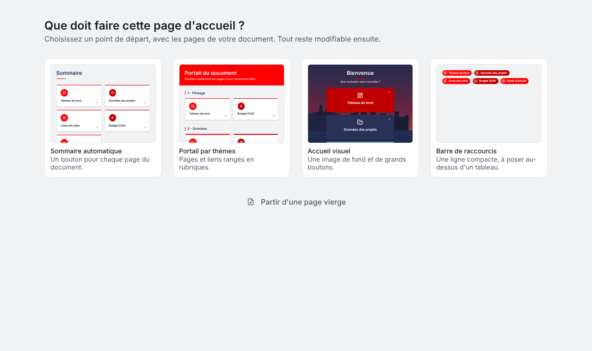
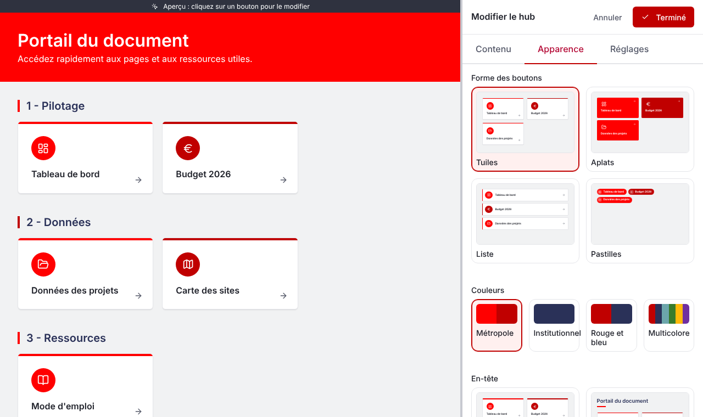
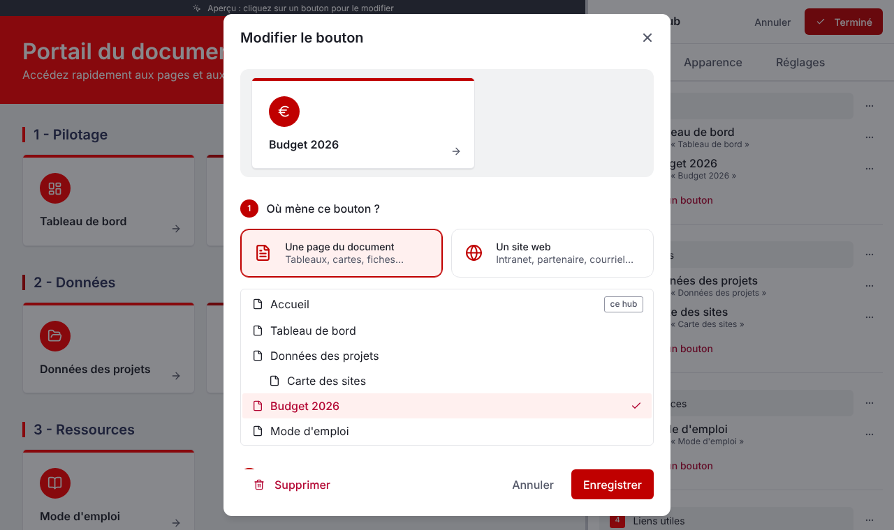

# Hub de navigation — widget Grist 🇫🇷

Widget personnalisé qui transforme une page Grist en **page d'accueil** : des boutons mènent vers les autres pages
du document ou vers des sites web. L'éditeur est visuel et guidé : on choisit un modèle, on répond à deux questions
par bouton, et toute l'apparence se règle à partir de miniatures. Le widget applique la **charte graphique de la
Métropole de Lyon** :
- rouges `#FF0000` / `#C00000`, bleu `#2A3158` ;
- police Segoe UI ;
- rubriques numérotées « 1 - … ».

| 1. Choisir un modèle | 2. Ajuster le contenu |
|---|---|
|  |  |
| **3. Régler l'apparence par miniatures** | **4. Un bouton = deux questions** |
|  |  |

Exemple de résultat (modèle « Accueil visuel ») :


## Utilisation

**Premier lancement : « Que doit faire cette page d'accueil ? »**

Quatre modèles, prévisualisés avec les vraies pages du document. La page qui contient le hub est exclue d'office.

| Modèle | Ce qu'il crée |
|---|---|
| Sommaire automatique | Un bouton par page. |
| Portail par thèmes | Les pages réparties en rubriques (Pilotage, Données, Ressources), plus des liens utiles. |
| Accueil visuel | Une image de fond et de grands aplats de couleur. |
| Barre de raccourcis | Des pastilles compactes, à placer au-dessus d'un tableau. |

On peut aussi partir d'une page vierge.

**Onglet Contenu**
- Les boutons sont rangés en rubriques ; le titre d'une rubrique se modifie sur place.
- Glisser-déposer, y compris d'une rubrique à l'autre.
- Menu `⋯` pour dupliquer, supprimer ou déplacer.
- Un encart signale les pages qui n'ont pas encore de bouton et les ajoute en un clic.

**Un bouton, deux questions**
1. *Où mène-t-il ?* Une page du document (choisie dans la liste) ou un site web (`https://`, `mailto:`, `tel:`).
2. *À quoi ressemble-t-il ?* Libellé (par défaut, le nom de la page), description, icône (70 icônes, recherche en
   français), couleur de la charte.

Un aperçu en direct montre le bouton final. Cliquer sur un bouton de l'aperçu du hub l'ouvre aussi pour modification.

**Onglet Apparence** : chaque réglage se choisit sur une miniature du hub.

| Réglage | Choix |
|---|---|
| Charte graphique | Métropole de Lyon, ou DSFR (Système de design de l'État : Bleu France, tuiles droites à liseré, police Marianne si elle est installée) |
| Forme des boutons | tuiles, aplats, liste, pastilles |
| Couleurs | Métropole (rouge alterné), institutionnel, rouge et bleu, multicolore |
| En-tête | aucun, sobre, encadré, bandeau rouge ; titre, sous-titre et logo |
| Fond | par défaut, couleur, image (adresse ou fichier importé, compressé automatiquement), avec un voile réglable |
| Disposition | taille, alignement, colonnes |

**Onglet Réglages**
- Pied de page.
- Numérotation des rubriques.
- Bouton « Modifier » visible ou non.
- Adresse du document.
- Changement de modèle.
- Copie ou import de la configuration (pour réutiliser un hub dans un autre document).

**En lecture**
- Les lecteurs seuls ne voient jamais le bouton « Modifier ».
- Le hub suit le thème clair ou sombre de Grist et s'adapte au mobile.

## Installation

1. Ajoutez un widget **Personnalisé** sur une page (par exemple « Accueil »), sur n'importe quelle table.
2. Choisissez **URL personnalisée** et collez :
   ```
   https://arthurpanck.github.io/grist-widget/hub/index.html
   ```
3. Accordez l'**accès complet** au document. Il sert uniquement à lire la liste des pages et l'adresse du document ;
   le widget ne modifie aucune donnée.

> **Important — enregistrer.** Grist garde les réglages d'un widget « modifiés » tant qu'on ne les enregistre pas.
> Après **Terminé**, cliquez sur l'icône mise en évidence en haut à droite du widget, puis sur **Enregistrer**.

Les configurations créées avec la première version du hub sont reprises automatiquement :
- les groupes deviennent des rubriques ;
- les icônes sont converties.

## Conception et code

- La conception (parcours, écrans, principes, modèle de données) est décrite dans [DESIGN.md](DESIGN.md).
- L'interface repose sur des librairies maintenues, **copiées dans `vendor/`** et servies par GitHub Pages avec le widget : aucun CDN externe, aucune étape de compilation. Pour changer de version, modifiez `tools/vendor.sh` puis relancez `bash hub/tools/vendor.sh`.

| Librairie | Rôle |
|---|---|
| [Web Awesome](https://webawesome.com) 3.14 (MIT) | Composants : boutons, champs, onglets, dialogues, curseurs, notifications, panneau redimensionnable ; thèmes et utilitaires de mise en page. |
| [Vue](https://vuejs.org) 3.5 (MIT) | Gabarits déclaratifs et état réactif. |
| [Lucide](https://lucide.dev) 1.70 (ISC) | Icônes. |
| [SortableJS](https://sortablejs.github.io/Sortable/) 1.15 (MIT) | Glisser-déposer. |

| Fichier | Contenu |
|---|---|
| `index.html` | Gabarits des composants. |
| `hub.css` | Charte et apparence du hub. |
| `js/config.js` | Schéma, migration, modèles, palettes, icônes (sans dépendance). |
| `js/grist.js` | Échanges avec Grist. |
| `js/app.js` | Composants Vue. |
| `js/libs.js` | Point d'entrée des librairies de `vendor/`. |
| `vendor/`, `tools/vendor.sh` | Librairies embarquées (versions dans `vendor/VERSIONS.md`) et script qui les copie. |

La configuration est enregistrée dans les options du widget, sous la clé `hub` : rien n'est écrit dans les tables.
Ouvert hors de Grist, le widget affiche une démonstration avec des pages fictives.

> **DSFR.** La charte DSFR reprend le style visuel du Système de design de l'État, sans son bloc-marque « République Française » : l'usage officiel du DSFR est réservé aux sites de l'État. La police Marianne n'est pas embarquée ; elle s'affiche si elle est installée sur le poste, sinon Arial est utilisée.
