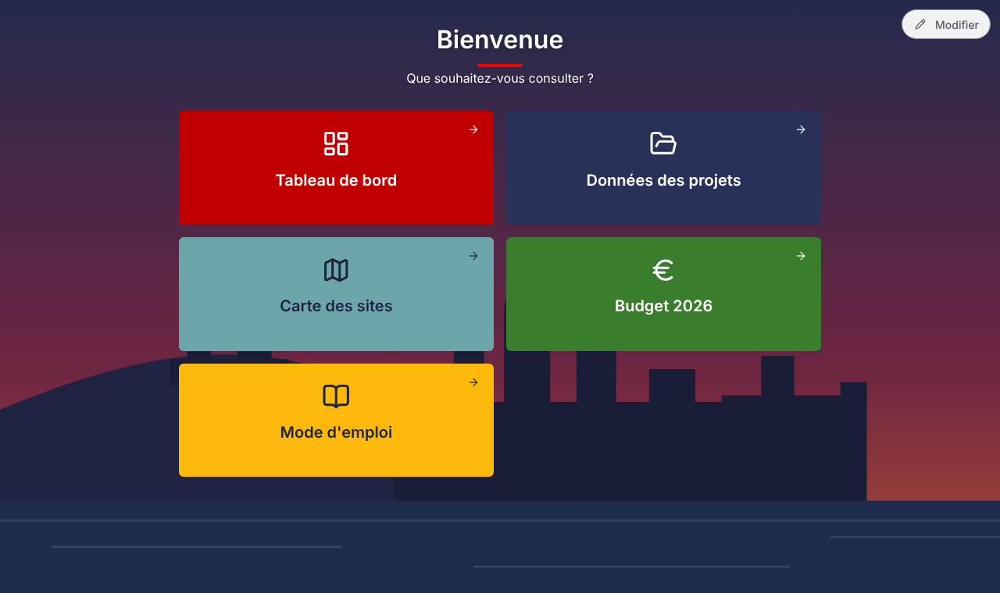

# Hub de navigation — widget Grist 🇫🇷

Widget personnalisé qui transforme une page Grist en **page d'accueil** : des boutons mènent vers les autres pages
du document ou vers des sites web. L'éditeur est visuel et guidé : on choisit un modèle, on répond à deux questions
par bouton, et toute l'apparence se règle à partir de miniatures. Le widget applique la **charte graphique de la
Métropole de Lyon** :
- rouges `#FF0000` / `#C00000`, bleu `#2A3158` ;
- police Segoe UI ;
- tuiles « Bloc icône » ;
- titres soulignés de rouge.

| 1. Choisir un modèle | 2. Ajuster le contenu |
|---|---|
|  |  |
| **3. Régler l'apparence par miniatures** | **4. Un bouton = deux questions** |
|  |  |

Exemple de résultat (modèle « Accueil visuel ») :



## Utilisation

Tout se fait sur la page elle-même. Un hub neuf commence par un titre et une rubrique vides.

Pour modifier un hub existant, ouvrez le menu du widget (⋮), puis **Ouvrir la configuration**. Les lecteurs ne
voient aucun bouton d'édition.

1. **Créer un bouton.** À la fin de chaque rubrique, une case « Ajouter un bouton » attend à l'endroit où le
   bouton apparaîtra. Elle contient un seul champ, « Vers où mène ce bouton ? », avec trois choix :
   - **Page** : on tape le nom d'une page du document (les pages sans bouton sont proposées en premier) ;
   - **Formulaire** : on choisit un des widgets « Formulaire » du document ; le bouton ouvre le formulaire en
     pleine page, dans un nouvel onglet ;
   - **Site web** : on tape ou on colle une adresse (une adresse collée dans « Page » est aussi reconnue) ;
   - **Entrée** crée le bouton, avec son nom et une icône devinée ;
   - le champ reste ouvert pour le bouton suivant ; **Échap** le referme.
2. **Modifier un bouton.** Un clic sur un bouton ouvre sa fiche, juste à côté :
   - nom, description, destination (« Changer »), icône ;
   - couleur : celle de la charte Métropole, une des 8 pastilles de la palette Metabase, ou une couleur
     personnalisée (pipette) ; le texte passe en blanc ou en foncé selon la couleur, pour rester lisible ;
   - icône : 6 suggestions, puis « Plus d'icônes » qui cherche dans toute la bibliothèque Lucide (plus de
     2 000 icônes), en français pour les plus courantes, en anglais pour toutes.

   La **petite croix** en haut à droite d'un bouton le supprime.
3. **Composer la page.** En bas du hub, « Ajouter : **Titre** · **Sous-titre** · **Rubrique de boutons** ».
   - Les titres se modifient sur place.
   - La corbeille d'un bloc le supprime.
   - Les titres, sous-titres et rubriques vides sont retirés en fin d'édition.
4. **Déplacer.** On glisse un bouton pour changer sa place dans sa rubrique ou l'envoyer dans une autre. On glisse un titre,
   un sous-titre ou une rubrique par sa poignée (⋮⋮, à gauche).
5. **Afficher.** Le bouton « Affichage » ouvre un panneau à droite, le hub restant visible :
   - image de fond (adresse ou photo importée) ;
   - disposition (taille, alignement, colonnes).

   Sans image, le fond « Halo métropolitain » est utilisé.

Un hub vide propose « Ajouter le premier bouton », ou de partir d'un modèle. Les lecteurs seuls ne voient jamais
les outils d'édition ; le hub suit le thème clair ou sombre de Grist et s'adapte au mobile.

## Installation

1. Ajoutez un widget **Personnalisé** sur une page (par exemple « Accueil »), sur n'importe quelle table.
2. Choisissez **URL personnalisée** et collez :
   ```
   https://arthurpanck.github.io/grist-widget/hub/index.html
   ```
3. Accordez l'**accès complet** au document. Il sert uniquement à lire la liste des pages et l'adresse du document ;
   le widget ne modifie aucune donnée.

> **Important — enregistrer.** Grist garde les réglages d'un widget « modifiés » tant qu'on ne les enregistre pas.
> Après **Terminé**, cliquez sur l'icône mise en évidence en haut à droite du widget, puis sur **Enregistrer**.

Les configurations créées avec la première version du hub sont reprises automatiquement :
- les groupes deviennent des rubriques ;
- les icônes sont converties.

## Conception et code

- La conception (parcours, écrans, principes, modèle de données) est décrite dans [DESIGN.md](DESIGN.md).
- L'interface repose sur des librairies maintenues, **copiées dans `vendor/`** et servies par GitHub Pages avec le widget : aucun CDN externe, aucune étape de compilation. Pour changer de version, modifiez `tools/vendor.sh` puis relancez `bash hub/tools/vendor.sh`.

| Librairie | Rôle |
|---|---|
| [Web Awesome](https://webawesome.com) 3.14 (MIT) | Composants : boutons, champs, onglets, dialogues, curseurs, notifications, panneau redimensionnable ; thèmes et utilitaires de mise en page. |
| [Vue](https://vuejs.org) 3.5 (MIT) | Gabarits déclaratifs et état réactif. |
| [Lucide](https://lucide.dev) 1.70 (ISC) | Icônes : toute la bibliothèque, en une planche (`vendor/lucide/sprite.svg`). |
| [SortableJS](https://sortablejs.github.io/Sortable/) 1.15 (MIT) | Glisser-déposer. |

| Fichier | Contenu |
|---|---|
| `index.html` | Gabarits des composants. |
| `hub.css` | Charte et apparence du hub. |
| `js/config.js` | Schéma, migration, modèles, palettes, icônes (sans dépendance). |
| `js/grist.js` | Échanges avec Grist. |
| `js/app.js` | Composants Vue. |
| `js/libs.js` | Point d'entrée des librairies de `vendor/`. |
| `vendor/`, `tools/vendor.sh` | Librairies embarquées (versions dans `vendor/VERSIONS.md`) et script qui les copie. |

La configuration est enregistrée dans les options du widget, sous la clé `hub` : rien n'est écrit dans les tables.
Ouvert hors de Grist, le widget affiche une démonstration avec des pages fictives.

> **DSFR.** La charte DSFR reprend le style visuel du Système de design de l'État, sans son bloc-marque « République Française » : l'usage officiel du DSFR est réservé aux sites de l'État. La police Marianne n'est pas embarquée ; elle s'affiche si elle est installée sur le poste, sinon Arial est utilisée.
