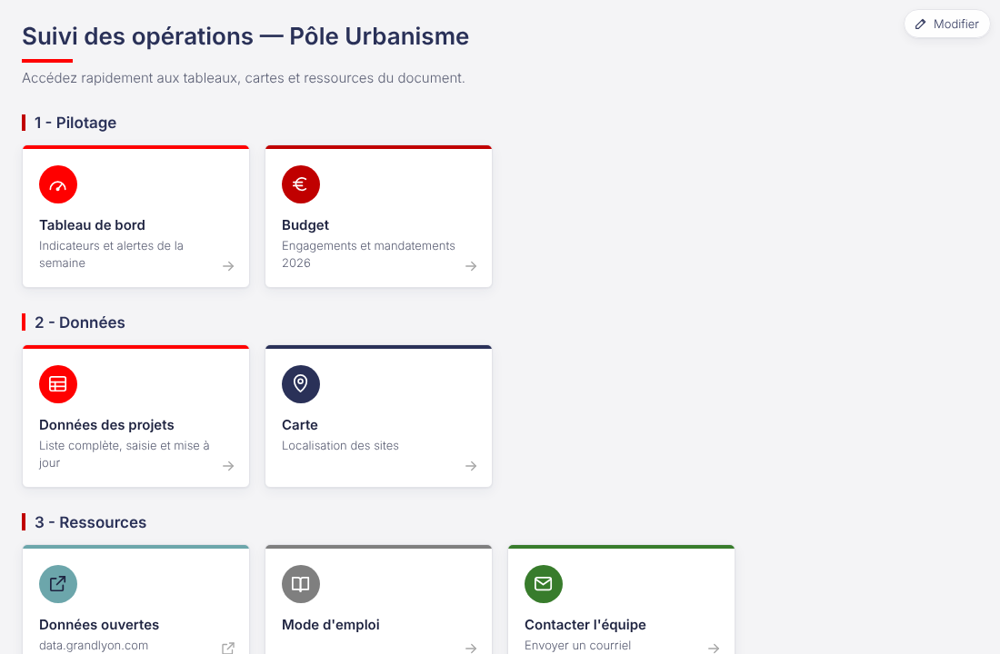
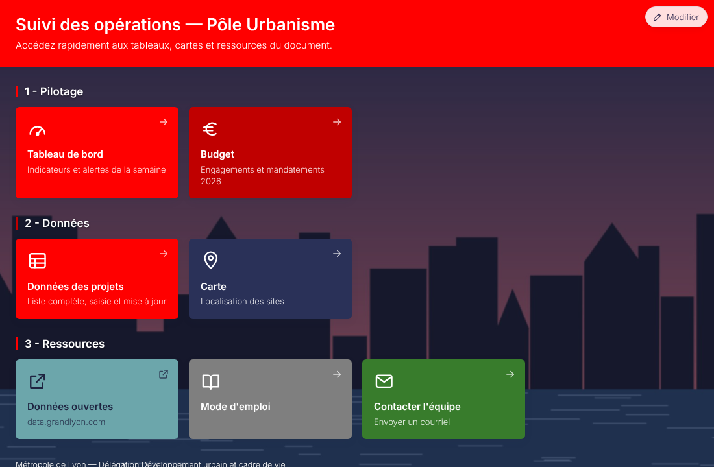
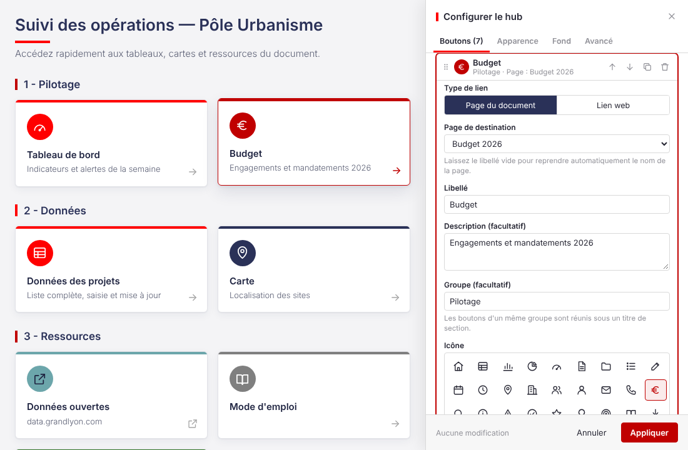

# Hub de navigation — widget Grist 🇫🇷

Widget personnalisé qui transforme une page Grist en **page d'accueil** : des boutons cliquables mènent vers
les autres pages du document ou vers des sites web. Fond (couleur ou image), logo, titres et couleurs sont
réglables sans écrire de code, dans le respect de la **charte graphique de la Métropole de Lyon**
(rouges `#FF0000` / `#C00000`, bleu `#2A3158`, typographie Segoe UI, titres numérotés « 1 - … »).

| Tuiles | Aplats sur image de fond | Panneau d'édition |
|---|---|---|
|  |  |  |

## Fonctionnalités

- **Boutons vers les pages du document** : choix dans la liste des pages ; le libellé reprend
  automatiquement le nom de la page s'il est laissé vide. « Un bouton par page » crée tous les boutons en un clic,
  avec une icône devinée d'après le nom de la page.
- **Liens externes** (`https://`, `mailto:`, `tel:`), en option dans un nouvel onglet. Les adresses dangereuses
  (`javascript:` …) sont refusées.
- **Groupes** : les boutons d'un même groupe sont réunis sous un titre de section, numéroté selon la charte.
- **4 styles de boutons** : tuiles, aplats de couleur, liste, pastilles — en 3 tailles, colonnes automatiques ou fixes,
  alignement à gauche ou centré.
- **Couleurs de la charte** : alternance automatique rouge / rouge foncé, ou couleur au choix (bleu institutionnel,
  bleu canard, vert, ambre, orange, violet, gris…), avec un contraste du texte adapté à chaque fond.
- **34 icônes** intégrées (ou un emoji).
- **En-tête** : titre, sous-titre, logo (URL ou fichier importé) ; style sobre, encadré ou bandeau rouge.
- **Fond** : couleur ou image (URL ou fichier importé, compressé automatiquement), voile sombre ou clair
  réglable pour garder le texte lisible, ajustement et position.
- **Pied de page** libre.
- **Édition visuelle** avec aperçu en direct : cliquer sur un bouton de l'aperçu l'ouvre dans le panneau,
  glisser-déposer pour réordonner, dupliquer, supprimer.
- **Export / import** de la configuration en JSON (pour la réutiliser dans un autre document).
- Les **lecteurs seuls** ne voient jamais le bouton « Modifier ». Affichage adapté au mobile.

## Installation

1. Ajoutez un widget **Personnalisé** sur une page (par exemple une page « Accueil »), sur n'importe quelle table.
2. Choisissez **URL personnalisée** et collez :
   ```
   https://arthurpanck.github.io/grist-widget/hub/index.html
   ```
3. Accordez l'**accès complet** au document : il sert uniquement à lire la liste des pages et l'adresse du document
   (le widget ne modifie aucune donnée).
4. Cliquez sur **Créer un bouton par page** ou **Configurer le hub**.

> **Important — enregistrer la configuration.** Comme pour un filtre, Grist garde les réglages d'un widget
> en « modifié » tant qu'on ne les enregistre pas. Après **Appliquer** dans le panneau du hub, cliquez sur
> l'icône mise en évidence en haut à droite du widget puis sur **Enregistrer**.

### Ouvrir le panneau d'édition

- survolez le hub et cliquez sur **Modifier** (en haut à droite) ;
- ou, dans le panneau de droite de Grist, onglet **Widget**, cliquez sur **Ouvrir la configuration**
  (utile si le bouton « Modifier » a été masqué dans l'onglet *Avancé*).

## Navigation vers les pages

Un bouton « page » ouvre `…/doc/<id du document>/p/<numéro de page>` dans l'onglet courant. L'adresse du document est
détectée automatiquement grâce à l'accès complet. Si ce n'est pas possible (accès restreint, instance particulière),
collez l'adresse du document dans **Avancé › Adresse du document** : tout ce qui suit `/p/…` est ignoré.

## Stockage

Toute la configuration est enregistrée dans les options du widget, sous la clé `hub` : rien n'est écrit dans les
tables du document. Les images importées sont redimensionnées (1920 px pour un fond, 480 px pour un logo) et stockées
dans ces options ; pour des images lourdes, préférez une adresse web.

Exemple de configuration (format accepté par l'import) :

```json
{
  "header": { "title": "Suivi des projets", "subtitle": "", "logo": "", "style": "bandeau", "align": "left" },
  "background": { "type": "image", "image": "https://…/photo.jpg", "veil": 0.4, "veilColor": "dark", "fit": "cover", "position": "center" },
  "layout": { "style": "tuile", "size": "m", "columns": 0, "align": "left", "numbering": true, "maxWidth": 1200 },
  "footer": "Métropole de Lyon",
  "buttons": [
    { "label": "", "description": "Liste des projets", "icon": "tableau", "color": "auto", "kind": "page", "page": 2, "group": "Pilotage" },
    { "label": "Site de la Métropole", "icon": "externe", "color": "bleu", "kind": "url", "url": "https://www.grandlyon.com", "newTab": true, "group": "Liens utiles" }
  ]
}
```

## Développement

Le widget est écrit en HTML / CSS / JavaScript sans dépendance ni étape de compilation (`index.html`, `hub.css`,
`hub.js`). Ouvert directement dans un navigateur, hors de Grist, il affiche une configuration de démonstration.
