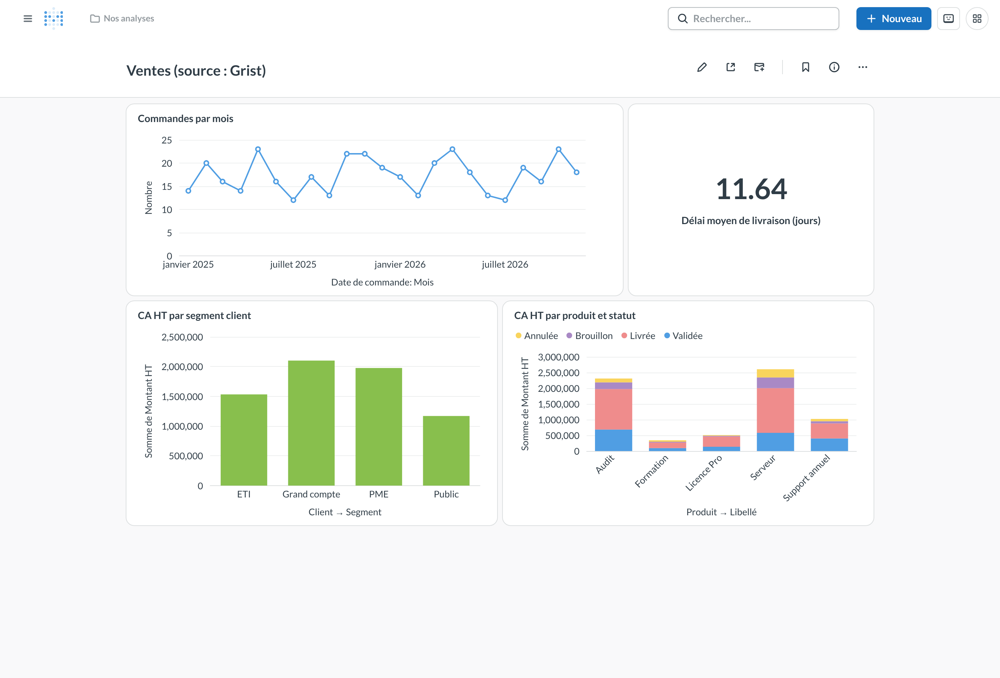
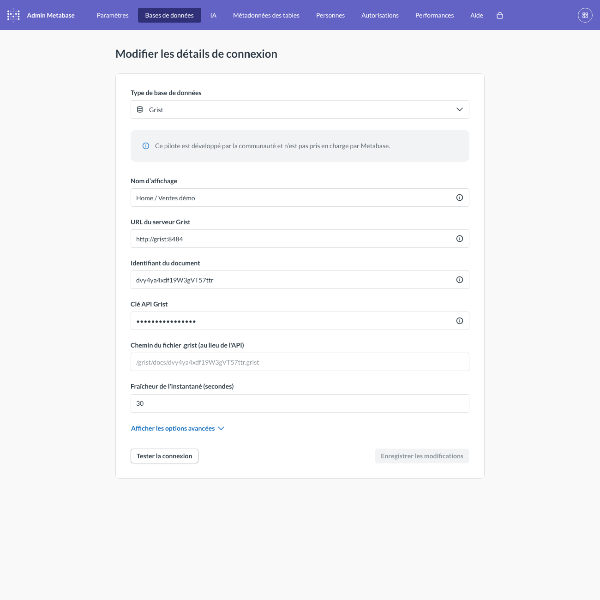

# Grist → Metabase : connecteur et bilan d'intégration

Ce dossier contient un pilote Metabase pour **Grist**, une stack `docker compose` de démonstration, des manifestes
OpenShift et le bilan des tests (Grist `latest` et Metabase v0.65.7.3, novembre 2026).



## TL;DR

| Question | Réponse |
|---|---|
| Existe-t-il un connecteur open source Grist ↔ Metabase ? | **Non.** Rien sur GitHub. Le forum Grist conseille de pointer le pilote SQLite de Metabase sur le fichier `.grist`. |
| Est-ce que le pilote SQLite natif de Metabase marche sur un `.grist` ? | **Ça se connecte en 5 minutes, mais ce n'est pas exploitable en prod** (voir plus bas). |
| Faut-il beaucoup de code pour bien le faire ? | **Non** : environ 320 lignes de Clojure, sans aucune chaîne de build (le `.jar` n'est qu'un zip du source), plus un script Python optionnel d'auto-enregistrement. |
| Difficulté en prod sur OpenShift | **Moyenne** : rien de bloquant, mais un pilote communautaire à maintenir au rythme de Metabase, et un modèle de droits à repenser. |

## 1. La voie native (pilote SQLite intégré à Metabase)

Un document Grist est un fichier SQLite (`/persist/docs/<docId>.grist`). Il suffit de monter le volume de Grist dans
Metabase et d'ajouter une base « SQLite » qui pointe sur le fichier. Testé, ça se connecte, mais :

| Problème constaté | Gravité |
|---|---|
| **Les écritures Grist échouent** (`SQLITE_BUSY: database is locked`) pendant qu'une requête Metabase lit le fichier. Les utilisateurs Grist voient des erreurs. | Bloquant |
| **Les dates sont fausses** : Grist stocke des secondes Unix dans des colonnes déclarées `DATE`, que sqlite-jdbc lit comme des millisecondes (`2025-12-15` devient `1970-01-21`). Regrouper par mois ou par année renvoie `NULL`. Metabase refuse toute coercion sur ces colonnes. | Bloquant pour la dataviz |
| Les colonnes `DateTime` et les formules `Any` sont typées `BLOB` (`type/*`) et sont inutilisables dans l'éditeur graphique. | Fort |
| 32 tables internes `_grist_*` / `_gristsys_*` s'affichent à côté des tables métier. | Gênant |
| Les références (`Ref:`) ne sont pas des clés étrangères, donc aucune jointure automatique n'est proposée. | Gênant |
| Il faut un volume partagé entre les pods Grist et Metabase : PVC RWX, ou RWO sur le même nœud. Avec le stockage S3 de Grist, le fichier local n'est qu'un cache. | Fort sur OpenShift |
| L'interface ne propose pas l'option lecture seule. Avec `MB_WRITABLE_PATHS` restreint, l'ajout ne passe que par l'API (`"read-only?": true`). | Mineur |

## 2. Le connecteur `grist` (ce dossier)

Il s'agit d'un pilote Metabase qui hérite du pilote SQLite intégré (`driver/src/metabase/driver/grist.clj`) :

- **Il ne lit jamais le document vivant.** Il travaille sur un instantané local, rafraîchi au plus toutes les
  `refresh-seconds` secondes, obtenu de l'une de deux façons :
  - **Mode API** (recommandé) : `GET /api/docs/:docId/download?nohistory=true` avec la clé API d'un compte de
    service. Il n'y a aucun volume partagé, cela fonctionne avec le stockage S3 de Grist et cela traverse le réseau
    du cluster.
  - **Mode « règles Grist »** (case *Appliquer les règles d'accès Grist de ce compte*) : la copie est reconstruite
    depuis l'API `/records`, que Grist filtre avec les règles du compte de la clé (lignes, colonnes, tables). La
    base Metabase ne contient alors que ce que ce compte voit dans Grist (voir [SECURITE.md](SECURITE.md) §6).
  - **Mode fichier** : copie du `.grist` monté par la sauvegarde en ligne de SQLite, qui reste cohérente et ne
    verrouille la source que quelques millisecondes.
- Chaque requête ouvre sa propre connexion SQLite sur l'instantané courant, ce qui rend visible tout de suite un
  instantané qui vient d'être rafraîchi.
- **La synchronisation lit les métadonnées Grist** (`_grist_Tables`, `_grist_Tables_column`) :
  - les tables internes et les colonnes techniques (`manualSort`, `gristHelper_*`) sont masquées ;
  - `Date` et `DateTime` deviennent des dates (coercion `UNIXSeconds->DateTime`), ce qui permet de regrouper par
    jour, mois ou trimestre et de filtrer par période ;
  - `Ref:Table` devient une clé étrangère vers `Table.id`, d'où des jointures implicites (« Client → Segment ») ;
  - `Choice` devient une catégorie, et `ChoiceList`, `RefList` et `Attachments` du JSON ;
  - le libellé et la formule de chaque colonne vont dans sa description (« Montant HT — Formule : $Quantite * … »).
- En SQL natif, les colonnes `Date` sont relues correctement.
- Les protections du pilote SQLite sont conservées : lecture seule, `ATTACH` interdit, extensions interdites,
  `MB_READABLE_PATHS`.

`scripts/register_docs.py` enregistre tous les documents visibles par le compte de service, à raison d'une base
Metabase par document. Il est idempotent (testé avec une clé API Metabase et avec identifiant et mot de passe) et peut tourner en CronJob. Il applique aussi les libellés Grist comme noms
d'affichage Metabase (« Date de commande » plutôt que « Date Commande »).



### Tests réalisés (tous verts)

`scripts/smoke_test.py` rejoue la liste suivante. Relancez-le avant chaque montée de version de Metabase.

- La synchronisation donne 4 tables métier au lieu de 36, les FK sont créées et les dates coercées.
- Commandes par année, mois et trimestre ; filtre sur une période de `DateTime` ; délai moyen entre deux dates
  (`datetime-diff`).
- Chiffre d'affaires par segment client et par produit, par jointure implicite via les références.
- Le SQL natif renvoie de vraies dates pour les colonnes `Date`.
- Fraîcheur : une modification dans Grist est visible dans Metabase après `refresh-seconds`.
- Une requête Metabase de 6 s n'empêche plus les écritures Grist (aucun `SQLITE_BUSY`).
- Les ajouts de colonnes remontent à la synchronisation suivante.
- Les deux modes fonctionnent : API et fichier.
- Contraintes OpenShift simulées (UID aléatoire, GID 0, capacités supprimées, `no-new-privileges`) : Grist et
  Metabase plus le pilote fonctionnent de bout en bout en mode API.

## 3. Lancer la démo

```bash
./driver/build.sh                 # produit plugins/grist.metabase-driver.jar
```

```bash
docker compose up -d              # Grist :8484, Metabase :3000 (+ Postgres pour Metabase)
```

Si Docker Hub vous limite (erreur 429), passez par un miroir :
`GRIST_IMAGE=mirror.gcr.io/gristlabs/grist:latest METABASE_IMAGE=mirror.gcr.io/metabase/metabase:v0.65.7.3 POSTGRES_IMAGE=mirror.gcr.io/library/postgres:16-alpine docker compose up -d`.

Créez ensuite une clé API Grist (Profil → API), puis, dans Metabase, *Ajouter une base de données* → **Grist** avec
l'URL `http://grist:8484`, l'identifiant du document et la clé. Pour générer un document de démo :

```bash
GRIST_URL=http://localhost:8484 GRIST_API_KEY=... python3 scripts/seed_demo.py
```

## 4. OpenShift

`openshift/metabase-grist.yaml` contient le Deployment Metabase avec le pilote, le Service, la Route et le CronJob
d'auto-enregistrement. Rien ne demande de SCC particulier :

- le pilote est livré par une ConfigMap (`oc create configmap metabase-grist-driver --from-file=plugins/grist.metabase-driver.jar`)
  et copié par un initContainer dans un `emptyDir`, car Metabase exige un dossier de plugins accessible en écriture ;
- les instantanés vont dans un `emptyDir` (`/grist-cache`) ; c'est un cache reconstruit après chaque redémarrage ;
- Grist est joint par son Service (`http://grist:8484`), sans volume partagé ;
- la version de Metabase est épinglée (`v0.65.7.3`).

## 5. Sécurité

Voir **[SECURITE.md](SECURITE.md)** : compte de service Grist en lecture seule (testé), pourquoi ne jamais brancher
Metabase sur la base PostgreSQL de Grist (aucune donnée métier, mais toutes les clés API en clair), comportement face
aux règles d'accès fines, secrets, NetworkPolicy et droits Metabase.

## 6. Avis sur l'intégration en production

**Faisable, effort modéré.** Comptez 1 à 2 jours pour un ops OpenShift, plus la mise au point des droits. Les points
à arbitrer :

1. **Maintenance du pilote (risque principal, mais modéré).** Il s'appuie sur l'API interne des pilotes Metabase.
   D'après le [journal des changements](https://github.com/metabase/metabase/blob/master/docs/developers-guide/driver-changelog.md)
   entre les versions 0.50 et 0.65 (environ deux ans) :
   - une dizaine de versions touchent une fonction que le pilote utilise, presque toujours par un ajout compatible ;
   - une seule était cassante : la 0.63, qui a supprimé `describe-table-fks`, que le pilote n'utilise déjà plus.

   Il faut épingler la version de Metabase et passer `smoke_test.py` avant chaque montée de version. Les
   pilotes communautaires ne sont pas acceptés sur Metabase Cloud, mais c'est sans objet en auto-hébergé.
2. **Droits d'accès.** Le compte de service (fonction de Grist, à activer) doit pouvoir lire *tout* le document : Grist n'autorise `/download`
   qu'aux propriétaires ou aux comptes qui peuvent tout lire. Les règles d'accès fines de Grist (lignes ou colonnes)
   **ne sont pas reproduites** dans Metabase, ce sont les permissions Metabase qui prennent le relais :
   - par base, donc par document : OK en édition open source ;
   - par ligne (« sandboxing ») : seulement dans Metabase Pro/Enterprise.

   Réservez le SQL natif aux analystes de confiance : il voit tout l'instantané, y compris les tables `_grist_*`
   (règles ACL, pièces jointes…).
3. **Fraîcheur et charge.** Chaque instantané expiré est retéléchargé en entier, à la demande, par chaque pod
   Metabase. Ce n'est pas ce que fait le pilote SQLite natif, qui lit le fichier en place, mais c'est le prix pour ne
   pas bloquer Grist et se passer d'un volume partagé. Mesures sur 50 400 commandes :
   - le document sans historique pèse 3,4 Mo et se télécharge en 0,2 s (9,1 Mo avec l'historique) ;
   - en mode « règles Grist », la copie se reconstruit en environ 1 s. Pour de gros documents, augmentez
   `refresh-seconds` (300 s par défaut dans le CronJob). Au-delà de quelques centaines de Mo, préférez une réplication
   vers PostgreSQL.
4. **Une base Metabase par document.** Le script d'auto-enregistrement règle ce point, mais les tableaux de bord
   multi-documents passent par des questions séparées.
5. **Particularités Grist à connaître :**
   - une référence vide vaut `0` et non `NULL` ;
   - les listes de choix sont du JSON ;
   - en SQL natif, les colonnes `DateTime` restent en secondes : utilisez `datetime(col, 'unixepoch')` ;
   - les noms de tables sont les identifiants Grist, pas les titres de page.
6. **Côté Grist sur OpenShift, indépendamment du connecteur.** Sous UID aléatoire, Grist exécute les formules **sans
   sandbox** (`flavor=unsandboxed`) : un éditeur peut faire tourner du Python dans le pod. gVisor demande plus de
   droits que le SCC `restricted`, et le sandbox Pyodide n'a pas démarré dans mon test (cache Deno). C'est à traiter
   avec l'équipe plateforme.

**Non testé ici :**
- un vrai cluster OpenShift (seulement une simulation de ses contraintes avec Docker) ;
- le stockage S3 de Grist (le mode API passe par Grist, il devrait donc en être indépendant) ;
- l'authentification OIDC ;
- plusieurs réplicas Metabase ;
- des documents volumineux ;
- la validation des manifestes contre les schémas Kubernetes/OpenShift (seule leur syntaxe YAML a été vérifiée).

**Alternative sans code Metabase :** répliquer périodiquement les tables Grist vers PostgreSQL (script, n8n…) et
brancher Metabase sur PostgreSQL. C'est plus robuste pour de gros volumes, mais c'est un pipeline de plus à
exploiter et la fraîcheur est moindre.
